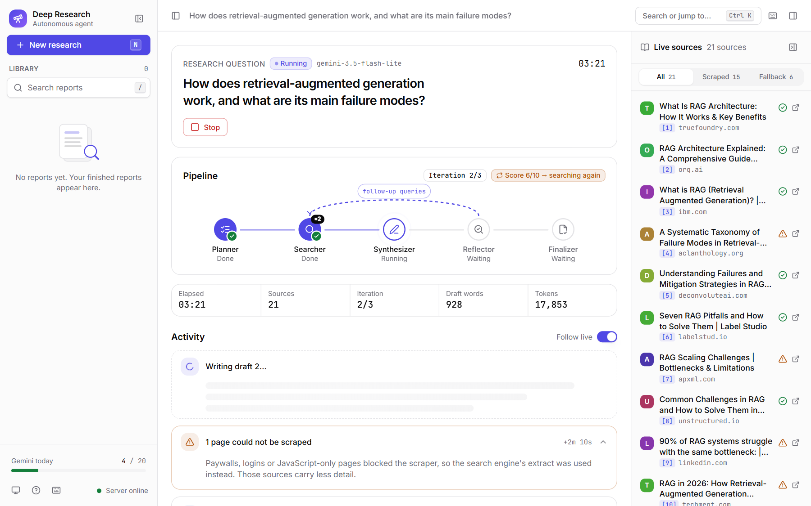
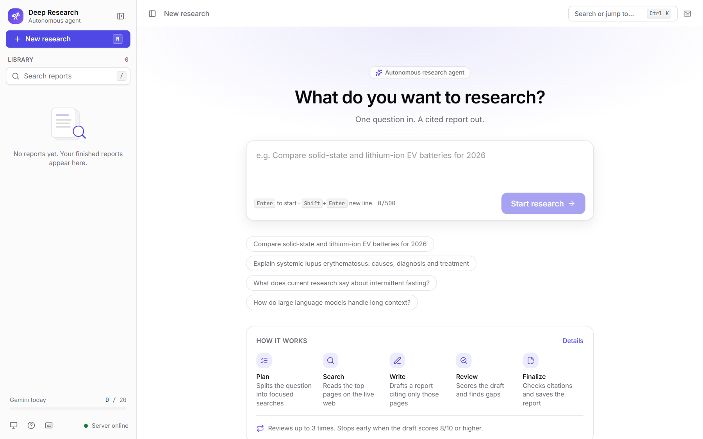
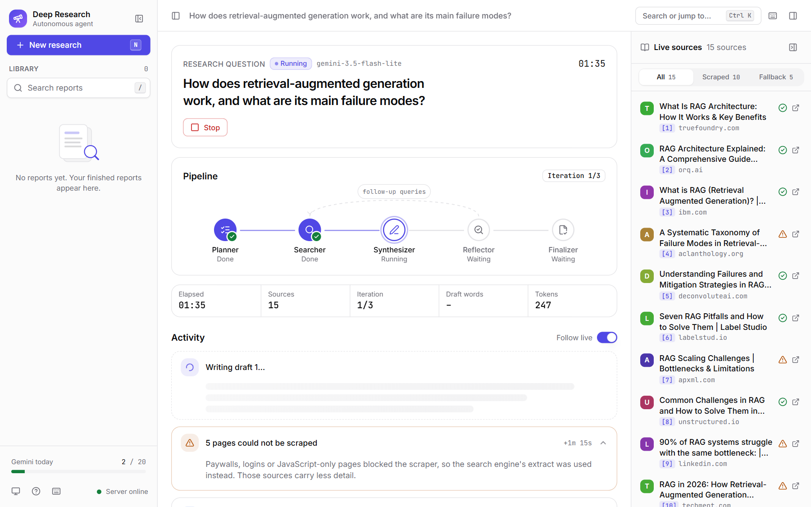
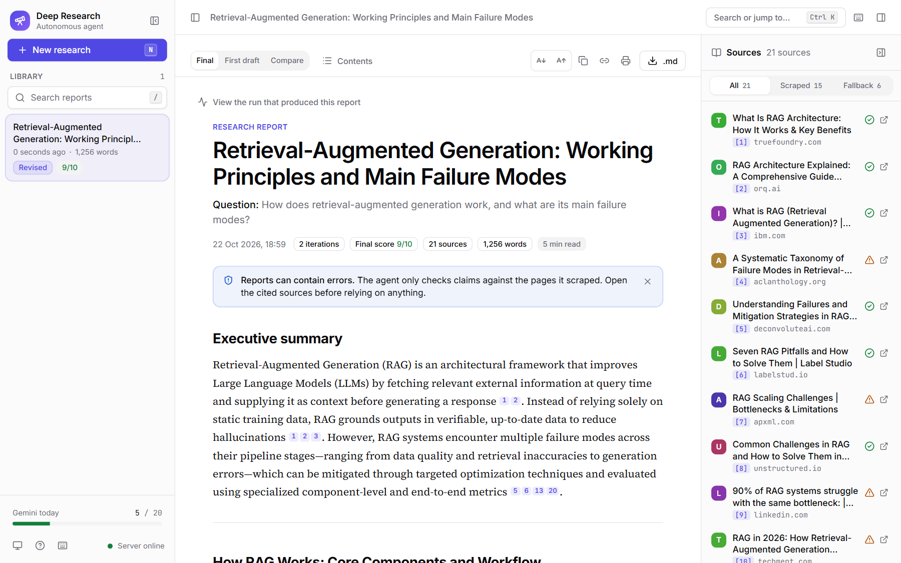
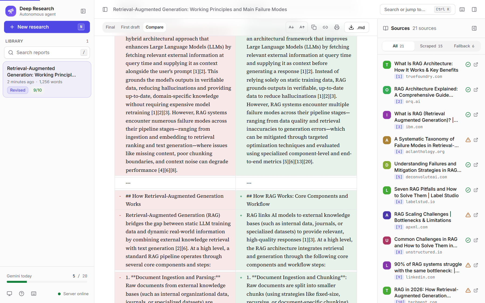
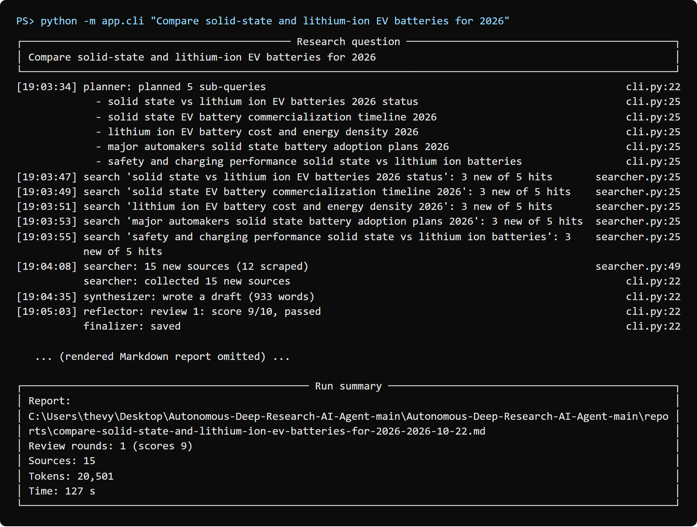
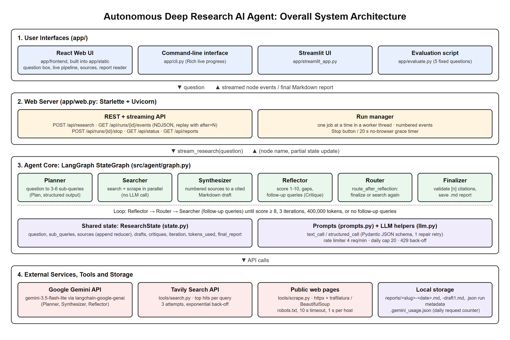
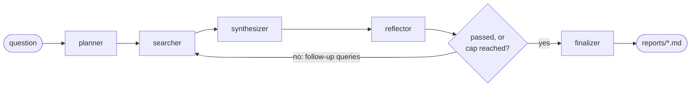

# Autonomous Deep Research AI Agent

A LangGraph agent that turns one research question into a cited Markdown
report. It plans sub-queries, searches and scrapes the live web, writes a
draft, reviews its own draft, and searches again until the gaps are filled or
a cap is hit.

> Reports can contain errors. The agent only checks claims against the pages
> it scraped, so open the cited sources before relying on anything it writes.



## Team: Prompt Pirates

Mini project for the **Agentic AI** course, B.Tech CSE-AIML, Semester VI,
Unitedworld Institute of Technology, Karnavati University, Gandhinagar
(academic year 2026–27).

| Student | Enrollment No. |
| --- | --- |
| Utpal Sakhiya | 202307020101 |
| Vyom Patel | 202307020084 |
| Harshil Dhamat | 202307020033 |
| Poojan Shihora | 202307020111 |

**Faculty guide:** Prof. Vaishnavi Chauhan, Assistant Professor, Department of
Computer Science & Information Technology.

**Project report:** [Word (.docx)](docs/Autonomous_Deep_Research_Agent_Project_Report.docx) ·
[PDF](docs/Autonomous_Deep_Research_Agent_Project_Report.pdf)

## Agentic AI concepts used

| Concept | In this project |
| --- | --- |
| Planning | Planner splits the question into 3–6 sub-queries (plan-and-execute); the reflector's follow-up queries re-plan later rounds |
| Tool calling | Tavily web search and a robots.txt-aware scraper, called by the searcher node (not LLM function calling) |
| Self-reflection | Reflector scores each draft 1–10, lists gaps and proposes follow-up searches; the loop stops at 8/10 |
| Memory | Short-term only: the shared `ResearchState` keeps sources, drafts and critiques for one run |
| RAG | Web retrieval-augmented generation: only retrieved, numbered sources may be cited (no embeddings or vector DB) |
| Multi-agent | Not used: one agent with five role-specialised nodes |
| Human-in-the-loop | No approval step: the user asks the question and can stop a run |

## Results (measured on 22 Oct 2026)

Three live runs with `gemini-3.5-flash-lite` at the free-tier limit of 4 requests/minute.
Raw logs are in [docs/test-results](docs/test-results) and the generated reports
in [docs/sample-reports](docs/sample-reports).

| Run | Question | Interface | Review scores | Sources (scraped) | Time | Tokens |
| --- | --- | --- | --- | --- | --- | --- |
| 1 | How does retrieval-augmented generation work, and what are its main failure modes? | Web UI | 6 → 9 | 21 (15) | 306 s | 43,270 |
| 2 | Compare solid-state and lithium-ion EV batteries for 2026 | CLI | 9 | 15 (12) | 127 s | 20,501 |
| 3 | Is nuclear power necessary to reach net-zero emissions by 2050? | CLI | 9 | 15 (5) | 186 s | 12,410 |

- 3 of 3 runs completed; 18 of 18 Tavily searches succeeded; 32 of 51 pages
  (62.7%) were scraped, the rest fell back to the search snippet.
- 180 of 180 citation numbers in the final reports point to a listed source;
  the finalizer removed one invalid citation (`[2026]`) in run 1.
- Automated tests: 60 of 60 pytest tests and 44 of 44 Vitest tests passed
  (2 live-API pytest tests are deselected by default).
- Review scores come from the agent's own reflector, so they are a
  self-assessment, not a measure of factual accuracy.

## Screenshots

| Home | Live sources |
| --- | --- |
|  |  |
| **Finished report** | **First draft vs. revised report** |
|  |  |



## Setup

Requires Python 3.11 or newer, a Gemini API key (aistudio.google.com) and a Tavily API key
(free tier at tavily.com).

```bash
python -m venv .venv
# Windows: .venv\Scripts\activate     macOS/Linux: source .venv/bin/activate
pip install -r requirements.txt
cp .env.example .env        # then put your two keys in .env
```

`.env` is git-ignored. Never commit it.

## Usage

```bash
python -m app.cli "Compare solid-state and lithium-ion EV batteries for 2026"
python -m app.web                      # web UI at http://127.0.0.1:8000
streamlit run app/streamlit_app.py     # simpler Streamlit UI
python -m app.evaluate                 # run the 5 evaluation questions
pytest -q                              # unit + end-to-end tests (no network, no keys)
pytest -m live                         # optional tests against the real APIs
```

Each run saves `reports/<slug>-<date>.md`. When the review loop revised the
report, the first draft is saved next to it as `...-draft1.md` so the two can
be compared.

The web UI (`python -m app.web`) streams each step as it happens: a live
pipeline with the review loop, the research plan, sources as they are read
(with scrape status), each draft and its review score. Finished reports open
in a reader with citation previews, a table of contents, Markdown download,
print-to-PDF and, when the review loop revised the report, a side-by-side
comparison with the first draft. It runs one research job at a time, shows
today's Gemini request count, reconnects if the connection drops, and stops
the agent when you press Stop or close the tab (or after 20 seconds with no
browser connected). Set `WEB_HOST` / `WEB_PORT` in `.env` to change where it
listens. End users need nothing beyond Python: the built UI is committed in
`app/static/`.

## Frontend development

The web UI's source is a Vite + React 18 + TypeScript app in `app/frontend/`
(Tailwind CSS, shadcn/ui on Radix, Zustand, TanStack Query, framer-motion).
`npm run build` writes the production build into `app/static/`, which
`python -m app.web` serves. You only need Node to change the UI.

Requires Node 20 or newer.

```bash
cd app/frontend
npm install
python -m app.web        # in another terminal: the API on http://127.0.0.1:8000
npm run dev              # UI with hot reload on http://localhost:5173, proxying /api
npm run build            # type-check, then build into app/static/
npm test                 # Vitest: event reducer, stepper, citations, diff, components
npm run lint             # ESLint
npm run typecheck        # tsc for the app and the Vite config
```

`npm run dev` proxies `/api` to `BACKEND_URL` (default
`http://127.0.0.1:8000`); copy `app/frontend/.env.example` to
`app/frontend/.env` to change it. Commit the rebuilt `app/static/` along with
your source changes.

## Architecture





Five nodes share one state object (`ResearchState` in `src/agent/state.py`).
Each node is a function that takes the state and returns a partial update.

| Node | Reads | Writes |
| --- | --- | --- |
| Planner | question | sub_queries, iteration = 0 |
| Searcher | sub_queries or follow_up_queries, sources | new sources (appended) |
| Synthesizer | question, sources, critique | draft |
| Reflector | question, draft | critique, follow_up_queries, iteration + 1 |
| Finalizer | draft | final_report, a file in reports/ |

**Why a graph.** The loop, the shared state and the conditional branch are
the point: a single prompt cannot go back and search for what its first
answer was missing.

**Why `sources` has a reducer.** It is declared
`Annotated[list[dict], operator.add]`, so each searcher pass appends to the
list instead of replacing it. Source numbers therefore stay stable across
loops, and a citation `[4]` means the same page in every draft.

**What stops the loop.** `route_after_reflection` in `src/agent/graph.py`
sends the run to the finalizer when any of these is true:

- the reflector scored the draft 8 or higher (`passed` is derived from the
  score in code, not taken from the model),
- `MAX_ITERATIONS` (3) drafts have been reviewed,
- the run has used `MAX_TOKENS_PER_RUN` tokens,
- the reflector proposed no follow-up queries.

LangGraph's `recursion_limit` is set as a final backstop.

**How hallucinated citations are limited.**

- The synthesizer sees only numbered sources and is told to write
  "insufficient evidence" instead of guessing.
- The Sources list is generated in code from `state["sources"]`, so every URL
  in a report is one that was actually fetched.
- The finalizer removes any `[n]` that does not match a source.

**Scraping.** 10 s timeout, browser-like User-Agent, `robots.txt` respected,
one second between requests to the same host, text truncated to 6000
characters. A failed scrape returns `None`; the searcher then falls back to
the search engine's extract for that page, and never crashes the graph.

## Configuration

All limits are in `src/agent/config.py`. The model defaults to
`gemini-3.5-flash-lite`; set `MODEL_NAME` in `.env` to use another Gemini model.

## Project layout

```text
src/agent/
  config.py  state.py  llm.py  prompts.py  graph.py
  tools/   search.py  scrape.py
  nodes/   planner.py  searcher.py  synthesizer.py  reflector.py  finalizer.py
app/       cli.py  web.py  streamlit_app.py  evaluate.py  run.py
  frontend/  React + TypeScript source for the web UI (npm run build)
  static/    built web UI served by web.py (generated, committed)
tests/     one file per piece, plus an end-to-end test with fakes
reports/   generated reports (git-ignored)
docs/      project report, screenshots, diagrams, sample reports, test logs
```

## Example output

Illustrative shape of a run; your scores, sources and timings will differ.

```text
$ python -m app.cli "Compare solid-state and lithium-ion EV batteries for 2026"
planner: planned 5 sub-queries
searcher: collected 14 new sources
synthesizer: wrote a draft (1180 words)
reflector: review 1: score 6/10, 3 gaps found
searcher: collected 7 new sources
synthesizer: wrote a draft (1540 words)
reflector: review 2: score 8/10, passed
finalizer: saved reports/compare-solid-state-and-lithium-ion-ev-batteries-for-2026-2026-10-10.md
```

```markdown
# Solid-State vs Lithium-Ion EV Batteries in 2026

## Executive summary
Lithium-ion remains the only chemistry in volume production ... [1][3]

## Energy density
...

## Sources
1. [Title of the first scraped page](https://example.com/page)
2. ...
```

## Limitations

- Paywalled, login-only and JavaScript-rendered pages mostly fail to scrape.
- Results inherit the search engine's ranking bias.
- No fact-checking beyond the scraped sources: a wrong source gives a wrong,
  correctly cited claim.
- Each run costs LLM tokens; the token cap is checked between drafts, so a
  run can exceed it by one draft and one review.

## References

- P. Lewis et al., "Retrieval-augmented generation for knowledge-intensive NLP tasks," NeurIPS 2020.
- S. Yao et al., "ReAct: Synergizing reasoning and acting in language models," ICLR 2023.
- N. Shinn et al., "Reflexion: Language agents with verbal reinforcement learning," NeurIPS 2023.
- A. Madaan et al., "Self-Refine: Iterative refinement with self-feedback," NeurIPS 2023.
- Y. Shao et al., "Assisting in writing Wikipedia-like articles from scratch with large language models" (STORM), NAACL 2024.
- [LangGraph](https://langchain-ai.github.io/langgraph/), [Gemini API](https://ai.google.dev/gemini-api/docs),
  [Tavily](https://docs.tavily.com/), [trafilatura](https://trafilatura.readthedocs.io/),
  [Pydantic](https://docs.pydantic.dev/), [Starlette](https://www.starlette.io/), [React](https://react.dev/).

The full reference list is in Chapter "References" of the [project report](docs/Autonomous_Deep_Research_Agent_Project_Report.pdf).
